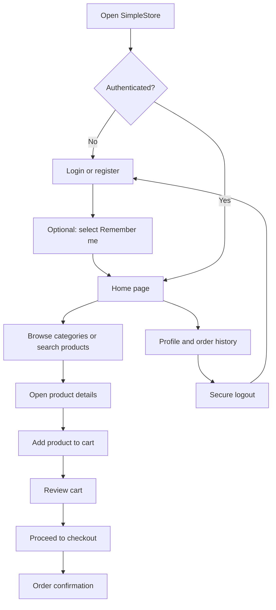

# SimpleStore

A Django e-commerce storefront for clothing and electronics. It includes authentication, product browsing and search, category navigation, cart and checkout flows, customer reviews, and a responsive interface.

## Features

- Login, registration, logout, and **Remember me** sessions
- Protected storefront pages
- Clothing and electronics product catalogues
- Product search, categories, product details, reviews, and related products
- Session-based shopping cart and checkout flow
- Responsive home, login, and product layouts
- Production-ready Django configuration with WhiteNoise and PostgreSQL support

## Tech stack

- Python 3.11+
- Django 5.2
- SQLite for local development
- PostgreSQL support for production
- HTML, CSS, JavaScript, Font Awesome

## Application workflow



1. A visitor creates an account or signs in. Selecting **Remember me** keeps the session active on that device.
2. After authentication, the visitor reaches the home page and can browse categories or search the full catalogue.
3. Selecting a product opens its detail page, including price, description, reviews, and related products.
4. The visitor adds products to the session-based cart, reviews quantities and totals, then proceeds to checkout.
5. After checkout, an order confirmation is shown. Signed-in users can view their order history from their profile.
6. Logout securely ends the session and returns the visitor to the login page.

## Run locally

Open PowerShell in the project directory and run:

```powershell
.\venv\Scripts\python.exe manage.py runserver
```

Visit <http://127.0.0.1:8000/> in your browser.

The application redirects visitors to the login page. Create an account first, then sign in to access the store.

## Import product datasets

The project includes a clothing dataset and a Croma electronics CSV.

```powershell
# Imports clothing products from Dataset/data.csv.
# Warning: this command clears existing products before importing.
.\venv\Scripts\python.exe manage.py import_data

# Imports electronics product names, prices, and image URLs.
.\venv\Scripts\python.exe manage.py import_electronics
```

To assign the local fallback images used by the electronics products on the home page:

```powershell
.\venv\Scripts\python.exe manage.py assign_homepage_electronics_images
```

## Production deployment

See [DEPLOYMENT.md](DEPLOYMENT.md) for environment variables, build commands, database setup, and media-storage guidance.

Before deploying, set production environment variables such as `DJANGO_SECRET_KEY`, `DJANGO_ALLOWED_HOSTS`, `DJANGO_CSRF_TRUSTED_ORIGINS`, and `DATABASE_URL`. Never commit secrets to Git.

## Screenshots


## License

This project is for personal and educational use.
